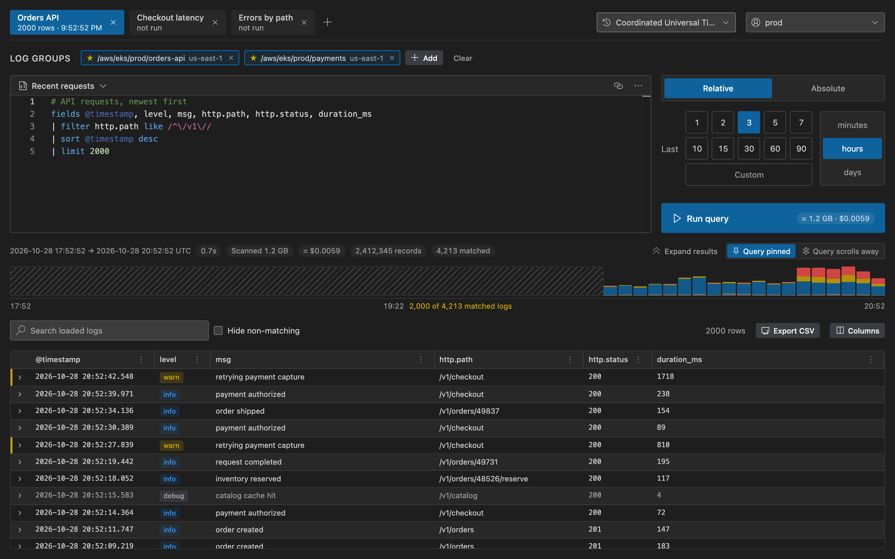
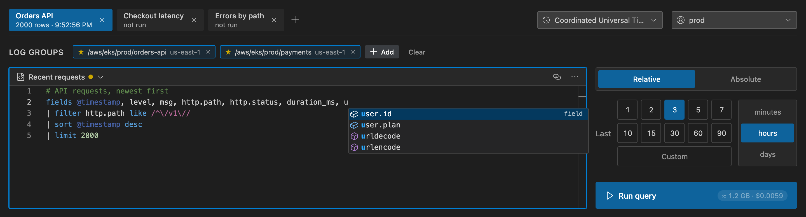
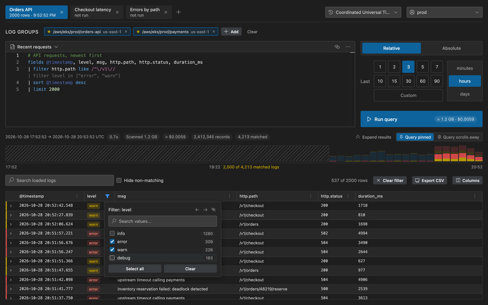
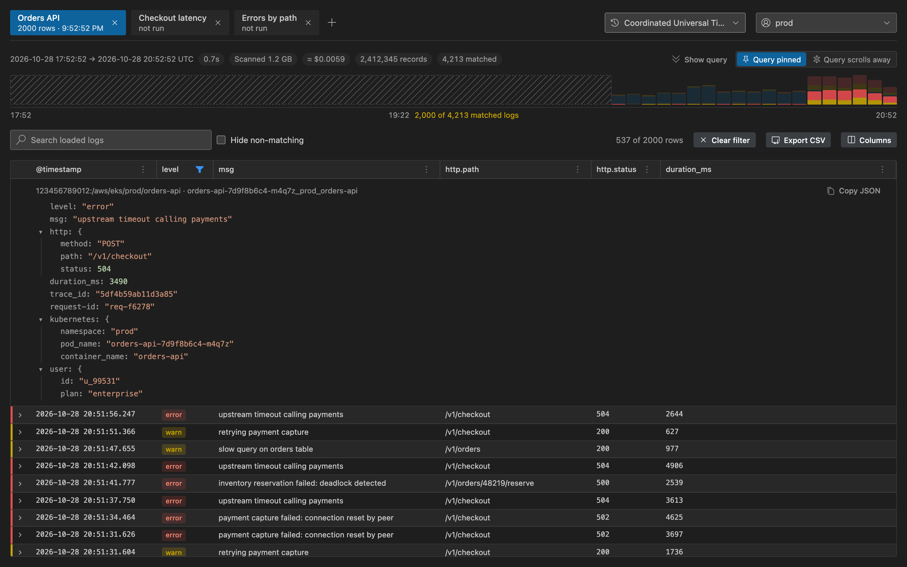
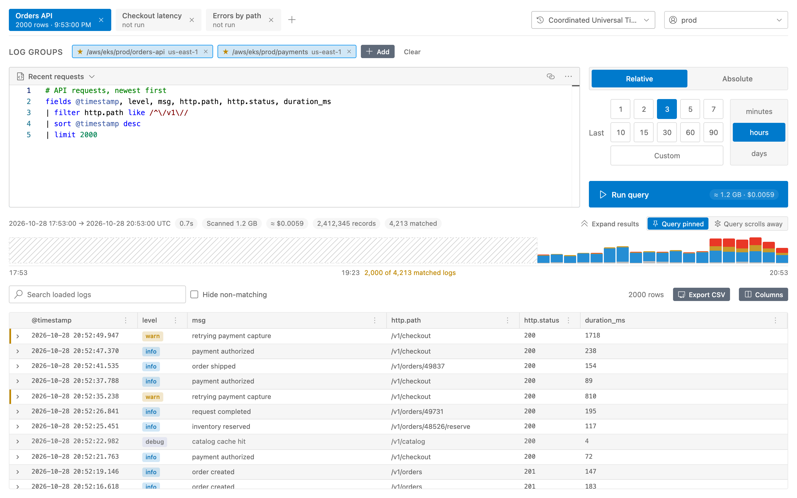

# CloudWatch Logs Viewer

**CloudWatch Logs Insights in a VS Code tab.** Write queries with autocomplete and syntax checks, see what a
query will cost before you run it, and dig through the results with a histogram, column filters and the full
JSON of every log. Queries go straight from VS Code to AWS with your own credentials: no backend, no account,
no telemetry.



## Highlights

- **Tabs.** Every tab keeps its own log groups, query, time range and results.
- **A real query editor.** Highlighting, autocomplete for commands, functions and your logs' fields, and errors
  underlined as you type.
- **Cost before you run.** The Run button shows how much the query would scan and what that costs, from
  CloudWatch's free `estimate`.
- **Results you can work with.** A histogram by level, value filters with counts, search, extra columns from the
  raw JSON, and the whole log event one click away.
- **Fast.** Waits for queries without downloading partial results, and downloads results compressed.

## Getting started

1. Install the extension.
2. Make sure the AWS CLI works on your machine (`aws sts get-caller-identity`); the extension uses the same
   profiles. For SSO, run `aws sso login --profile <name>` first.
3. Run **CloudWatch Logs: Open Viewer** from the Command Palette (`Ctrl/Cmd+Shift+P`), pick a profile in the
   top-right corner, add log groups and press `Ctrl/Cmd+Enter`.

## Features

### Query editor



- Logs Insights highlighting, and autocomplete for commands, functions and fields: the fields CloudWatch saw in
  the selected log groups, plus fields of their raw JSON logs from your recent queries.
- Checks against the documented syntax: errors underlined in red, unknown commands and functions in yellow.
- Saved queries: save, save as, rename and delete. A dot shows when the query differs from what was saved.
- `Ctrl/Cmd+Enter` runs, `Ctrl/Cmd+S` saves, `Ctrl/Cmd+/` comments lines.

### Know the cost before you run

The Run button shows what the query would scan and what that costs, like `≈ 1.2 GB · $0.0059`. The figure comes
from CloudWatch itself: the query with `| estimate` at the end, which scans nothing and is free. It updates on its
own after you change the log groups or the time range, and when you stop typing. Finished queries show what
they actually scanned and cost.

### Filter what you loaded



- A histogram of the loaded rows, stacked by log level. Drag across it to zoom in; **Run for this range** runs
  the query for just that window. Logs that matched but did not fit the `limit` are shown hatched; click there to
  load them.
- Column filters list every value with its count. Search highlights matches, or hides everything else.
- Active filters appear in the editor as faint `| filter …` lines. Click one to add it to the query.
- Resize, hide and reorder columns, and add any field from the raw JSON log as a column.
- Export CSV: the shown or all loaded rows, any columns, and the raw `@message`, `@log`, `@logStream`.

### Every log in full



Expand a row to see the whole log event as a JSON tree, with its log group and stream, even when the query
selected only a few fields. Every value can filter the table or be added to the query.

### And more

- **Time ranges.** Quick relative ranges, or absolute ones with a calendar. Absolute fields take pasted times in
  many formats: ISO, epoch seconds or milliseconds, `08.10.2026 22:59`, `now-1h`, or a whole `A - B` range.
- **Time zones.** Absolute times and results are shown in the zone you pick: UTC, your local zone or any other.
- **Favorites.** Star log groups to keep them one click away. Groups from different regions can be queried together.
- **Layouts.** Keep the query on top and let the table take the rest, or let the query scroll away with the logs.
- **Links.** Copy a `vscode://` link to a query, with a relative range or pinned to the last run, and send it to a
  teammate. Opening it puts the query in a new tab.
- **Your theme.** The viewer follows VS Code's colours, light or dark.



## Requirements

Any AWS credentials the AWS SDK can find: profiles in `~/.aws/config` and `~/.aws/credentials` (static keys,
`role_arn` with `source_profile`, SSO, `credential_process`) or environment variables.

The IAM permissions it uses:

```json
{
  "Effect": "Allow",
  "Action": [
    "logs:DescribeLogGroups",
    "logs:GetLogGroupFields",
    "logs:StartQuery",
    "logs:GetQueryResults",
    "logs:StopQuery",
    "logs:DescribeQueries"
  ],
  "Resource": "*"
}
```

Without `logs:DescribeQueries` queries still work, but large results take longer.

## Settings

| Setting | Default | Description |
| --- | --- | --- |
| `cloudwatchLogsViewer.awsProfile` | empty | Profile the viewer starts with. Empty uses the default credential chain. It can also be switched in the viewer. |
| `cloudwatchLogsViewer.defaultRegion` | `us-east-2` | Region for browsing log groups. |
| `cloudwatchLogsViewer.costPerGb` | `0.005` | USD per GB scanned, for cost estimates. |
| `cloudwatchLogsViewer.queryTimeoutMs` | `1800000` | How long to wait for a query before stopping it, in milliseconds. |

## How it works

- Queries run with the AWS SDK: `StartQuery`, then the query's status is checked with `DescribeQueries`, and the
  results are downloaded once with `GetQueryResults`, gzip-compressed. **Stop** calls `StopQuery`, so AWS stops
  scanning too.
- Every query asks for `@message`, `@log` and `@logStream` alongside its own fields, so an expanded row can show
  the whole log. A query that already returns `@message` does not get it twice.
- Tabs, favorites, saved queries and the time zone are kept in VS Code's global state. Results stay in memory
  while the viewer is open.
- **View → Output → CloudWatch Logs** shows each query's log groups, range, timings and download size.

## Feedback

Bugs and ideas: [GitHub issues](https://github.com/catdarick/vscode-cloudwatch-logs-viewer/issues).

## License

[MIT](LICENSE)
